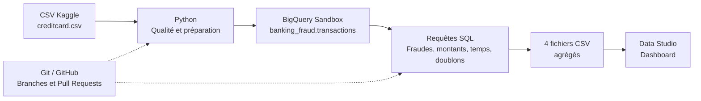
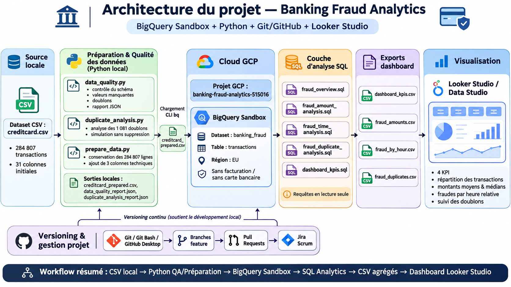
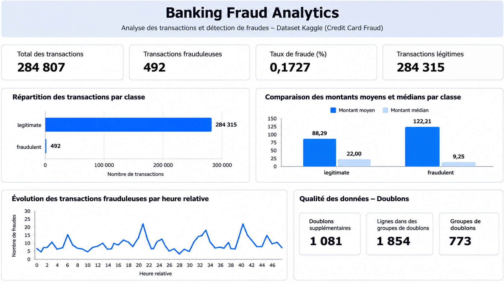

# Banking Fraud Analytics

**Analyse des transactions bancaires et des fraudes avec Python, Google BigQuery Sandbox, SQL et Data Studio (Looker Studio).**

Ce projet de portfolio Data Analyst met en place une chaîne analytique complète : contrôle de la qualité des données, préparation locale, chargement dans BigQuery, analyses SQL, export d'indicateurs agrégés et visualisation dans un tableau de bord.

> **Périmètre :** il s'agit d'une analyse descriptive d'un jeu de données historique, et non d'un système de détection en temps réel ou d'un modèle de machine learning.

## 1. Objectifs du projet

- Explorer la fréquence des transactions frauduleuses et légitimes.
- Comparer les montants moyens et médians des deux classes.
- Étudier l'évolution des fraudes par **heure relative**.
- Mesurer les doublons et leur incidence potentielle sans supprimer de données.
- Présenter les résultats dans un dashboard Data Studio.
- Documenter et versionner le travail avec Git et GitHub.

## 2. Technologies utilisées

| Outil | Rôle |
|---|---|
| **Python / pandas** | Audit qualité, analyse des doublons et préparation des données |
| **Google BigQuery Sandbox** | Stockage et exécution des requêtes SQL, sans activation de la facturation |
| **SQL (GoogleSQL)** | Calcul des indicateurs et analyses agrégées |
| **BigQuery CLI (`bq`)** | Chargement des données et exports CSV locaux |
| **Data Studio / Looker Studio** | Visualisation et création du tableau de bord |
| **Git / GitHub** | Versionnement, branches et Pull Requests |

## 3. Données utilisées

**Source :** jeu de données public *Credit Card Fraud Detection* (Kaggle), fichier `creditcard.csv`.

| Indicateur | Valeur |
|---|---:|
| Transactions totales | **284 807** |
| Transactions légitimes (`Class = 0`) | **284 315** |
| Transactions frauduleuses (`Class = 1`) | **492** |
| Taux de fraude | **0,1727 %** |
| Colonnes initiales | **31** |
| Colonnes après préparation | **34** |
| Valeurs manquantes | **0** |
| Lignes supplémentaires dupliquées | **1 081** |

Les 31 champs initiaux comprennent `Time`, `V1` à `V28`, `Amount` et `Class`. La préparation ajoute les colonnes techniques `source_row_id`, `is_duplicate_extra` et `is_in_duplicate_group`.

**Choix méthodologique :** les **284 807 transactions d'origine sont conservées**, y compris les doublons. Le champ `Time` est un nombre de secondes écoulées depuis le début de l'enregistrement ; les heures étudiées ne sont donc **pas des heures civiles**. La devise du champ `Amount` n'est pas spécifiée dans le jeu de données.

## 4. Architecture du projet



Le chargement vers BigQuery et les exports de résultats sont effectués avec l'outil `bq`. La visualisation s'appuie sur des **exports CSV agrégés** plutôt que sur une connexion directe BigQuery à Data Studio.

### Schéma d'architecture



*Illustration simplifiée de la chaîne de traitement. Vérifier le nom et l'extension de l'image dans `docs/` avant publication.*

## 5. Organisation du dépôt

```text
banking-fraud-analytics/
├── src/
│   ├── data_quality.py
│   ├── duplicate_analysis.py
│   └── prepare_data.py
├── sql/
│   ├── transactions_schema.json
│   ├── validate_transactions.sql
│   ├── fraud_overview.sql
│   ├── fraud_amount_analysis.sql
│   ├── fraud_time_analysis.sql
│   ├── fraud_duplicate_analysis.sql
│   └── dashboard_kpis.sql
├── dashboard/
│   └── (exports CSV agrégés locaux)
├── docs/
│   ├── (documentation du jeu de données)
│   ├── architecture.png
│   └── dashboard.png
└── README.md
```

Les fichiers CSV bruts/préparés et les exports de travail locaux ne sont pas nécessaires à la consultation du code sur GitHub.

## 6. Pipeline analytique

### Étape 1 — Qualité et préparation des données

- `src/data_quality.py` : contrôle du schéma, des valeurs manquantes et des doublons.
- `src/duplicate_analysis.py` : analyse des groupes de doublons et de l'impact hypothétique d'une déduplication.
- `src/prepare_data.py` : préparation du CSV avec trois colonnes techniques, sans suppression de lignes.

### Étape 2 — Stockage BigQuery

- **Projet Google Cloud :** `banking-fraud-analytics-515016`
- **Dataset :** `banking_fraud`
- **Table :** `transactions`
- **Région :** `EU`
- **Nombre de lignes chargées :** `284807`

Le projet utilise **BigQuery Sandbox**, sans compte de facturation activé. Les tables Sandbox peuvent être soumises à une expiration automatique : il ne s'agit pas d'un stockage permanent garanti.

### Étape 3 — Analyses SQL

| Script SQL | Analyse |
|---|---|
| `fraud_overview.sql` | Volumes de transactions et taux de fraude |
| `fraud_amount_analysis.sql` | Totaux, moyennes, médianes et extrêmes des montants |
| `fraud_time_analysis.sql` | Transactions et fraudes par heure relative |
| `fraud_duplicate_analysis.sql` | Qualité des données et doublons |
| `dashboard_kpis.sql` | Indicateurs globaux destinés au dashboard |

Les requêtes d'analyse sont en **lecture seule**.

### Étape 4 — Exports et dashboard

Les analyses alimentent quatre sources CSV locales utilisées dans Data Studio :

| Export | Contenu |
|---|---|
| `dashboard_kpis.csv` | KPI globaux |
| `fraud_amounts.csv` | Montants par classe |
| `fraud_by_hour.csv` | Fraudes par heure relative |
| `fraud_duplicates.csv` | Indicateurs de doublons |

## 7. Principaux résultats

### Répartition des transactions

- **284 315** transactions légitimes (environ **99,8273 %**).
- **492** transactions frauduleuses (environ **0,1727 %**).
- Le jeu de données est **fortement déséquilibré**.

### Montants par classe

| Classe | Montant moyen | Montant médian |
|---|---:|---:|
| Légitime | **88,29** | **22,00** |
| Frauduleuse | **122,21** | **9,25** |

Les fraudes ont un **montant moyen plus élevé**, mais un **montant médian plus faible**. Les valeurs sont présentées sans symbole monétaire, car la devise n'est pas documentée.

### Analyse temporelle

L'export temporel validé couvre **48 heures relatives** et reconstitue les **284 807 transactions**, dont **492 fraudes**.

### Qualité des données

| Indicateur | Valeur |
|---|---:|
| Doublons supplémentaires | **1 081** |
| Lignes appartenant à des groupes de doublons | **1 854** |
| Groupes de doublons | **773** |

La déduplication est uniquement étudiée à titre **hypothétique** : aucune ligne n'a été retirée de la table d'analyse.

## 8. Dashboard Data Studio

Le dashboard est conçu autour de quatre KPI globaux, d'une comparaison des volumes par classe, d'une comparaison des montants moyens et médians, d'une courbe des fraudes par heure relative et d'un suivi des doublons.



*Visuel de présentation du dashboard. Si l'image est une maquette, elle ne doit pas être présentée comme une capture réelle de Data Studio. Vérifier le nom et l'extension du fichier avant publication.*

## 9. Limites de l'analyse

- Les variables `V1` à `V28` sont anonymisées et ne permettent pas une interprétation métier directe.
- Le champ `Time` est relatif ; aucune analyse par date calendaire ou heure locale n'est possible avec ces données seules.
- La devise des montants n'est pas connue.
- L'analyse est descriptive et ne produit **ni prédiction ni détection en temps réel**.
- Les CSV du dashboard sont des **instantanés** des résultats au moment de leur export, pas des données actualisées automatiquement.

## 10. Dépôt et méthode de travail

Le projet est organisé par étapes, avec développement sur branches dédiées, commits, pushes et Pull Requests vers `main`.

**Dépôt GitHub :** [datasifaw/banking-fraud-analytics](https://github.com/datasifaw/banking-fraud-analytics)

---

**Projet de portfolio Data Analyst — Python · SQL · BigQuery Sandbox · Data Studio · GitHub**
